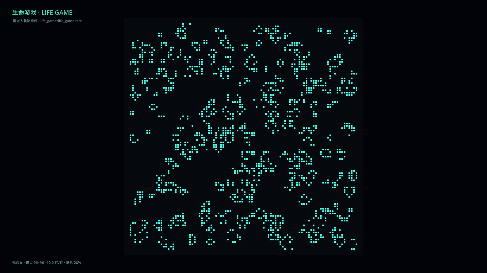
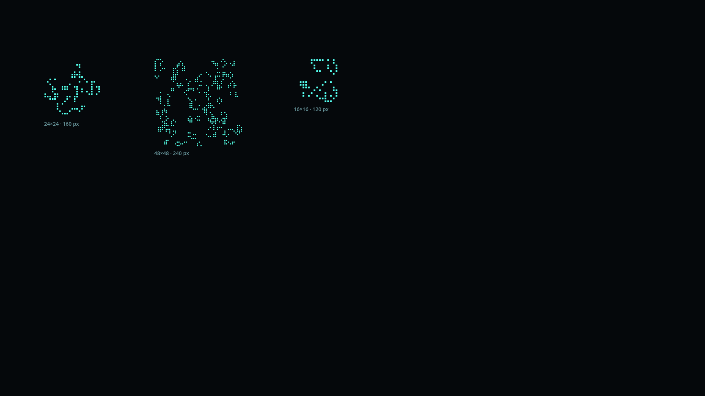

# 演播室2 插件：life_game（生命游戏）

可嵌入的康威生命游戏装饰组件。**它的主要用途不是独占一个直播场景**，而是作为一个
任意大小的子节点，放进其它插件 / 直播场景里当背景、边框或小装饰。

- X×X 格点（默认 64×64，2–512 可调）；
- 可选的初始状态：随机、6 个内置图案、自定义多行文本；
- 可调推演速度（0–60 代/秒，支持小数）；
- 边界外恒为死细胞，不环绕；
- 推演在独立棋盘上进行：父节点裁切、组件移出屏幕、缩放都不影响整张棋盘的计算；
- 渲染链支持任意层 `ShaderMaterial`（SubViewport 后处理链），默认自带「细胞调色板 + 泛光」两层。

演示（900×900，96×96 随机初始，10 代/秒）：



安装：把本仓库内容放到 `{exe}/mods/life_game/`。演示场景在控制面板的直播场景列表里
显示为「生命游戏（装饰模板）」，也可以直接：

```powershell
godot_console.exe --path <core> -- --scene life_game_demo
```

---

## 1. 复制到其它插件（推荐用法）

> 铁律：插件不引用插件。**不要**在运行时 `load("res://mods/life_game/...")` 或
> 跨插件 `get_node`。正确做法是把组件目录复制进你自己的插件，随你的插件一起分发。

把本仓库的 `life_game/` 整个目录复制到你自己的插件里（例如 `your_plugin/life_game/`），
然后：

1. 在你的场景里实例化 `life_game/life_game.tscn`；
2. 用 `position` / `size` / anchors 决定它显示在哪、多大；
3. 在检查器里调 `grid_size`、`steps_per_second`、初始状态等参数；
4. 需要改视觉时，改 `life_game/shaders/` 里的 shader，或往 `shader_layers` 数组追加自己的 ShaderMaterial。

组件不依赖内核服务、不依赖其它插件，也不使用 `class_name`，复制多份不会冲突。

任意尺寸（24×24 / 48×48 / 16×16，放在同一场景里的三个实例）：



最小示例：

```gdscript
var life := preload("res://your_plugin/life_game/life_game.tscn").instantiate()
life.position = Vector2(120, 80)
life.size = Vector2(240, 240)   # 方形节点 → 方形细胞；非方形会拉伸
life.grid_size = 32
life.steps_per_second = 6.0
add_child(life)
```

---

## 2. 参数（`life_game.tscn` 根节点）

| 参数 | 默认 | 说明 |
|---|---|---|
| `grid_size` | 64 | X×X 的边长（细胞数），2–512。修改会重建棋盘并重置初始状态。 |
| `steps_per_second` | 8.0 | 每秒推演代数；0 = 暂停；0.5 = 每 2 秒一代。 |
| `autostart` | true | 场景就绪后是否自动开始。 |
| `initial_mode` | 随机 | 随机 / 预设图案 / 自定义图案。 |
| `initial_preset` | 滑翔机 | 预设：滑翔机、闪烁器、脉冲星、橡果、R-五连体、高斯帕滑翔机枪。 |
| `custom_pattern` | 空 | 多行文本；`#` `1` `*` `O` `X` 为活细胞，其余（`.`、空格）为死细胞。会居中放置，超出棋盘的部分裁掉。 |
| `random_density` | 0.28 | 随机初始状态的活细胞密度。 |
| `random_seed` | 0 | 0 = 每次重置随机；非 0 = 可复现。 |

**初始状态不会在改参数时自动重来**：在检查器改完初始状态后重新进入场景，或调用
`reset()`。运行时改 `grid_size` 会自动重建。

### 棋盘与屏幕的关系

- 棋盘永远是 `grid_size × grid_size`，与组件的像素尺寸无关；
- 组件只是把整张棋盘纹理缩放到自己的矩形里；
- 因此组件被父容器裁切、部分移出屏幕、或缩得很小时，**所有格点仍然照常推演**；
- 边界外没有细胞，也没有环绕：滑翔机飞出边界就是消失了。

---

## 3. Shader 链

场景结构：

```
LifeGame (Control, life_game.gd)
├── BaseViewport (SubViewport, transparent_bg)
│   └── Mask (TextureRect, 显示 X×X RGBA8 掩码)
└── Output (TextureRect, 显示最后一层 ViewportTexture)

运行时由 shader_layers 数组创建：
Layer0 (SubViewport) → ColorRect + ShaderMaterial (life_cells)
Layer1 (SubViewport) → ColorRect + ShaderMaterial (life_glow)
...
```

- `Mask` 显示 `grid_size × grid_size` 的 RGBA8 掩码（白色不透明 = 活，透明 = 死）。
- `shader_layers` 是一个 `Array[ShaderMaterial]`，**数组顺序 = 后处理顺序**。
  每一层在自己的 `SubViewport` 里用一个全屏 `ColorRect` + 你的 `ShaderMaterial` 渲染。
- 脚本在运行时复制每层材质，并自动写入以下 uniform：

| uniform | 类型 | 含义 |
|---|---|---|
| `input_texture` | `sampler2D` | 上一层的输出；第一层是生命掩码。 |
| `grid_size` | `vec2` | X×X，用于按格计算形状/光晕。 |
| `generation` | `float` | 当前代数，可做随代数的动画。 |
| `display_size` | `vec2` | 本层 Viewport 的像素尺寸。 |

第一层拿到的是生命掩码；外层拿到的是内层输出的 RGBA。层数不限。

默认两层：

1. `life_cells.gdshader`：把掩码画成圆角细胞。可调 `alive_color`、`dead_color`、
   `cell_inset`（格间空隙）、`cell_roundness`、`edge_softness`。
   `dead_color` 默认 alpha=0，所以死细胞和间隙透明，露出父场景背景；想要实心网格就把
   alpha 调成 1。
2. `life_glow.gdshader`：8 方向泛光，半径以「格」为单位（`bloom_cells`），
   组件放大缩小光晕比例不变。不想要泛光就把 `bloom_strength` 设为 0，或从数组里删掉。

加一层自己的 shader：

1. 新建一个 `ShaderMaterial`，shader 写 `shader_type canvas_item;`；
2. 声明 `uniform sampler2D input_texture : repeat_disable, filter_linear;`；
3. 在 `fragment()` 里用 `texture(input_texture, UV)` 读取上一层，输出 `COLOR`（RGBA）；
4. 把材质追加到根节点的 `shader_layers` 数组；运行时改完数组后调用 `rebuild_layers()`。

每层请使用独立的 `ShaderMaterial`（脚本会再复制一份，避免共享 `input_texture`）。

---

## 4. 运行时 API

组件根节点（`life_game.gd`）提供：

| 成员 | 说明 |
|---|---|
| `reset()` | 按当前配置重新生成初始状态，代数归零。 |
| `pause()` / `resume()` / `set_paused(bool)` / `is_paused()` | 暂停 / 继续。 |
| `step_once()` | 手动推演一代（暂停时也可用）。 |
| `get_generation()` | 当前代数。 |
| `get_grid_size()` | 当前 X。 |
| `get_cell(x, y)` | 读取单个细胞；越界返回 false。 |
| `set_cell(x, y, alive)` | 暂停时手动画图；批量改完后调用 `refresh()`。 |
| `refresh()` | 把当前棋盘重新上传为纹理（不推演）。 |
| `rebuild_layers()` | 按当前 `shader_layers` 重建 SubViewport 后处理链。 |
| `get_layer_material(index)` | 取得运行时复制出的某层材质，可改自定义 uniform。 |
| `generation_advanced(generation)` | 每推演一代发出。 |
| `reset_finished` | 初始状态重建完成。 |

信号都是节点本地信号，不走 EventBus；需要跨插件通知时由宿主插件自己转成 EventBus 事件。

---

## 5. 性能与已知边界

- 推演是 CPU 上的 GDScript 双缓冲数组。开发机实测（无头、随机 30% 密度）：
  - 64×64 ≈ 2.4 ms/代
  - 128×128 ≈ 9.7 ms/代
  - 256×256 ≈ 39 ms/代
  - 512×512 ≈ 158 ms/代
- 因此 128×128 可以轻松 30 代/秒；256×256 建议 ≤ 10 代/秒；512×512 建议 ≤ 2 代/秒。
  更大棋盘请降低速度或直接把组件缩小显示（棋盘大小与显示大小无关）。
- 单帧最多补 4 代（`MAX_STEPS_PER_FRAME`），追不上时丢弃积压，避免无限追帧。
- 每次推演只上传一张 `grid_size × grid_size` 的 RGBA8 纹理；显示缩放由 GPU 完成。
- 组件根节点是 `Control`；放在 `Node2D` 父节点下时用 `position` / `size` 手动定位，
  放在 `Control` / 容器下时用 anchors / layout。
- 方形节点 → 方形细胞；非方形节点会把整张棋盘拉伸（这是有意的，方便塞进任意矩形）。
- 本组件不处理鼠标输入，不拦截事件。

---

## 6. 目录

```
life_game/                  # ← 复制这个目录到你的插件
├── life_game.tscn          # 组件场景
├── life_game.gd            # 推演循环、纹理、shader 链 uniform
├── life_board.gd           # 纯逻辑棋盘（无场景依赖，可单测）
└── shaders/
    ├── life_cells.gdshader
    └── life_glow.gdshader
scenes/life_game_demo.tscn  # 演示直播场景
scripts/life_game_demo.gd
_tests/                     # 测试（_ 前缀，不参与打包）
plugin.json
plugin.gd
```

---

## 7. 测试

纯逻辑测试（无头，CI 会跑）：

```powershell
godot_console.exe --headless --path <core> res://plugins/life_game/_tests/test_life_board.tscn
```

组件生命周期测试（无头，CI 会跑）：

```powershell
godot_console.exe --headless --path <core> res://plugins/life_game/_tests/test_life_game_component.tscn
```

视觉预览（需要真实窗口；2 秒后保存 `user://life_game_preview.png` 并打印路径）：

```powershell
godot_console.exe --path <core> res://plugins/life_game/_tests/test_life_game_preview.tscn
```

演示场景预览（需要真实窗口；保存 `user://life_game_demo_preview.png`）：

```powershell
godot_console.exe --path <core> res://plugins/life_game/_tests/test_demo_preview.tscn
```

小尺寸多实例预览（需要真实窗口；保存 `user://life_game_small_preview.png`）：

```powershell
godot_console.exe --path <core> res://plugins/life_game/_tests/test_small_preview.tscn
```

CI：`.github/workflows/smoke.yml` 在 core `main` 与 `core-v2.0.0` 上各跑一次
「纯逻辑测试 + 组件生命周期测试 + 无头冒烟」，断言插件被加载且日志无 `SCRIPT ERROR`。
